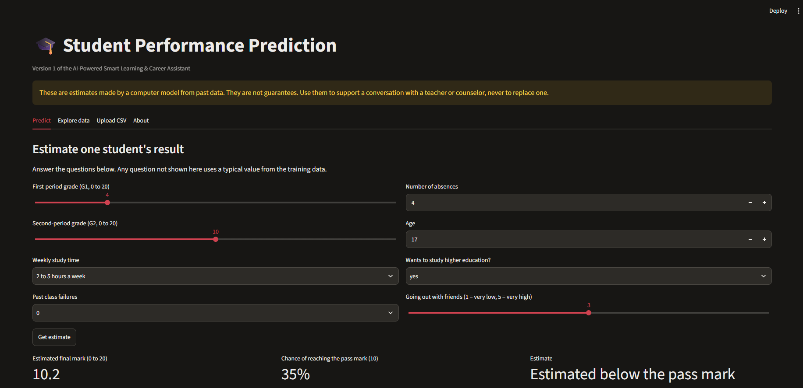

# AI-Powered Smart Learning & Career Assistant (AISLCA)


A course-long AI project built step by step in Python. Every version is a live,
deployable app.

**Current version: V1 - Student Performance Prediction System**

- **Live app:** https://aislca-student-performance.streamlit.app/
- **Code:** https://github.com/prajwal-sv/AI-Learning-Career-Assistant



> **Predictions are estimates, not guarantees.** They support teachers and
> students and never replace human judgment. See "Responsible use".

---

## Table of contents

1. [What V1 does](#1-what-v1-does)
2. [The live app](#2-the-live-app)
3. [The data](#3-the-data)
4. [How the project works (the big picture)](#4-how-the-project-works-the-big-picture)
5. [File-by-file guide](#5-file-by-file-guide)
6. [The models, the scoring and the results](#6-the-models-the-scoring-and-the-results)
7. [Student clustering (K-Means)](#7-student-clustering-k-means)
8. [Difficulties we met and how we solved them](#8-difficulties-we-met-and-how-we-solved-them)
9. [Run it yourself](#9-run-it-yourself)
10. [Testing, CI and deployment](#10-testing-ci-and-deployment)
11. [Responsible use and limitations](#11-responsible-use-and-limitations)
12. [Roadmap and credits](#12-roadmap-and-credits)

---

## 1. What V1 does

V1 uses a public student dataset to:

- clean and explore student data,
- show which factors relate to final marks (charts and statistical tests),
- group similar students with K-Means clustering,
- predict a student's **final mark (0 to 20)** and **chance of passing**,
- offer all of this in a free web app.

It is the first milestone of a larger plan (see the roadmap at the end).

## 2. The live app

**https://aislca-student-performance.streamlit.app/**

| Tab | What you can do |
|---|---|
| **Predict** | Answer 8 questions and get an estimated mark, a pass chance and a short result. The other inputs use typical values from the training data. |
| **Explore data** | Draw 6 charts: grade distribution, absences vs grade, study time, past failures, correlation heatmap, Math vs Portuguese averages. |
| **Upload CSV** | Upload a CSV of students. The app cleans it, estimates every student, and lets you download the results. |
| **About** | See the model scores, the confusion matrix and the responsible-use notes. |

A yellow "estimates, not guarantees" warning is shown on every page. Apps on
the free hosting go to sleep when nobody visits, so the first load can take a
minute.

## 3. The data

- **Dataset:** UCI Student Performance (public, CC BY 4.0).
  https://archive.ics.uci.edu/dataset/320/student+performance
- **Content:** 395 Math students and 649 Portuguese students from two
  Portuguese secondary schools, 33 columns each. Math is the main dataset;
  Portuguese is used for the subject comparison.
- **Target:** `G3`, the final grade on a 0 to 20 scale. A student passes when
  `G3 >= 10` (the pass mark is set in `configs/config.yaml`).
- No real or private student records are used anywhere in this project.

| Group of columns | Examples |
|---|---|
| Background | `school`, `sex`, `age`, `address`, `famsize`, `Pstatus`, `Medu`, `Fedu`, `Mjob`, `Fjob`, `reason`, `guardian` |
| Study habits and support | `traveltime`, `studytime`, `failures`, `schoolsup`, `famsup`, `paid`, `activities`, `nursery`, `higher`, `internet` |
| Social life and wellbeing | `romantic`, `famrel`, `freetime`, `goout`, `Dalc`, `Walc`, `health` |
| Academic results | `absences`, `G1` (first period), `G2` (second period), `G3` (final) |

**Important differences from the original project plan:** this dataset has no
attendance percentage and no assignment or quiz marks. We use `absences` as the
attendance signal and `G1`/`G2` as the earlier marks.

Citation: P. Cortez and A. Silva. *Using Data Mining to Predict Secondary
School Student Performance.* In A. Brito and J. Teixeira (Eds.), Proceedings of
the 5th FUture BUsiness TEChnology Conference (FUBUTEC 2008), pp. 5-12, Porto,
Portugal, April 2008, EUROSIS.

## 4. How the project works (the big picture)

```
 data/raw/ (original CSVs, never edited)
        |
        v   src/aislca/data/cleaning.py
 data/processed/ (cleaned CSVs)
        |
        +--> notebooks + src/aislca/analytics/   (charts and statistical tests)
        |
        v   src/aislca/data/features.py   (split, pass label, text -> numbers)
 train and test students
        |
        v   src/aislca/ml/train.py + evaluate.py   (compare models, pick the best)
 models/registry/student_model.joblib + metrics.json
        |
        v   src/aislca/ml/predict.py
 app.py (Streamlit)  --->  live web app
```

**Design rules we followed**

- Reusable logic lives in `src/`. Notebooks are only for exploring.
- The raw data is never edited. Cleaning writes a new file.
- All settings (pass mark, split size, clustering columns, model paths) live in
  one file: `configs/config.yaml`.
- The code is kept deliberately simple: small functions, plain names, comments
  above each step.

## 5. File-by-file guide

### Root files

| File | What it is for |
|---|---|
| `app.py` | The Streamlit web app. One small function per tab (`show_predict_tab`, `show_explore_tab`, `show_upload_tab`, `show_about_tab`), loaders `get_model_bundle` and `get_students` (cached so they load once), and `main` which builds the page. It adds `src/` to Python's path so it also runs on Docker and Streamlit Cloud. |
| `requirements.txt` | Packages with **exact versions**. A saved model file only loads safely with the same scikit-learn version that created it, so versions are pinned. |
| `pyproject.toml` | Makes the `aislca` package importable (`pip install -e .`) and holds the pytest setup. |
| `Dockerfile` | Builds an image that runs the app the same way everywhere. |
| `.dockerignore` | Keeps junk and secrets out of the Docker image. |
| `.gitignore` | Keeps `.venv`, caches, secrets and other junk out of Git. |
| `CHANGELOG.md` | What changed in each release. |
| `PROGRESS.md` | Task-by-task progress log and the summary used to plan the next version. |
| `README.md` | This file. |

### `configs/`

| File | What it is for |
|---|---|
| `config.yaml` | Settings: data file names and separator, target column and pass mark (10), valid value ranges for cleaning, train/test split (20% test, seed 42, 5-fold cross-validation), clustering columns and number of groups, and where the model and metrics files are saved. |

### `data/`

| File | What it is for |
|---|---|
| `raw/student-mat.csv`, `raw/student-por.csv` | The original UCI data (Math and Portuguese). Never edited. |
| `raw/student.txt`, `raw/student-merge.R` | Description and an R merge script that came with the download. Kept as downloaded. |
| `processed/student_mat_clean.csv`, `processed/student_por_clean.csv` | Cleaned data written by `cleaning.py`. The app reads these. |

### `notebooks/` (exploration only)

| File | What it is for |
|---|---|
| `01_data_analysis.ipynb` | Loading the data, cleaning checks, exploratory charts and statistical tests. |
| `03_machine_learning.ipynb` | Training and comparing models, K-Means clustering and the final evaluation. |

(There is no `02` notebook on purpose. The charts and statistics live at the
bottom of notebook 01.)

### `src/aislca/data/`

| File | Main functions | What they do |
|---|---|---|
| `ingestion.py` | `load_config`, `load_student_data`, `load_processed_data` | Read the config file, the raw CSVs and the cleaned CSVs. Also finds the project folder so paths work from anywhere. |
| `cleaning.py` | `missing_report`, `fix_types`, `fill_missing`, `remove_duplicates`, `remove_invalid_rows`, `find_outliers_iqr`, `clean_student_data`, `run_cleaning` | Finds missing values; strips spaces and forces numeric columns to numbers; fills gaps (median for numbers, most common for text); removes duplicate rows and impossible values (for example a grade of 25); reports outliers **without deleting them**. `run_cleaning` cleans both files and saves them. |
| `features.py` | `add_pass_label`, `get_feature_columns`, `split_data`, `prepare_inputs` | Adds the `passed` column (1 if `G3 >= 10`); chooses input columns with or without `G1`/`G2`; makes the stratified 80/20 train/test split; turns text answers (yes/no, GP/MS) into 0/1 columns and matches the training columns exactly. |

### `src/aislca/analytics/`

| File | Main functions | What they do |
|---|---|---|
| `eda.py` | `plot_grade_distribution`, `plot_scatter_vs_grade`, `plot_mean_grade_by`, `plot_correlation_heatmap`, `top_correlations`, `subject_averages`, `plot_subject_averages` | Reusable charts and summaries. They return figures, so notebooks and the app share the same code. |
| `stat_tests.py` | `correlation_tests`, `compare_two_groups`, `anova_by_group`, `chi_square_test` | Pearson and Spearman correlations; two-group comparisons (Welch t-test and Mann-Whitney) with Cohen's d; ANOVA and Kruskal-Wallis across 3+ groups; chi-square with Cramer's V. |

### `src/aislca/ml/`

| File | Main functions | What they do |
|---|---|---|
| `train.py` | `get_regression_models`, `get_classification_models`, `train_models`, `feature_importances`, `get_default_values`, `run_final_training` | Defines the models and baselines, trains them, shows which inputs a tree model uses most, computes typical values for every input, and runs the whole final process (choose, train, test once, save). Run it with `python -m aislca.ml.train`. |
| `evaluate.py` | `regression_metrics`, `classification_metrics`, `confusion_matrix_table`, `plot_confusion_matrix`, `compare_models`, `cross_validated_scores`, `pick_best_model`, `save_metrics_json` | All scoring: MAE, RMSE, R2, accuracy, precision, recall, F1, confusion matrix; cross-validation; the automatic "best model" choice that ignores baselines; saving scores to JSON. |
| `predict.py` | `load_model_bundle`, `predict_students`, `predict_one` | Loads the saved model file and predicts for one student or a whole table. Missing inputs get typical values; marks are kept between 0 and 20. |
| `clustering.py` | `scale_columns`, `try_different_k`, `run_kmeans`, `describe_clusters`, `plot_k_choice`, `plot_clusters` | Scales columns, tries k = 2 to 8 (elbow and silhouette), groups students, describes each group and draws them. |

### `models/registry/`

| File | What it is for |
|---|---|
| `student_model.joblib` | **One file with everything the app needs:** the best mark model, the best pass/fail model, the input column lists, typical default values and the pass mark. |
| `metrics.json` | The saved scores of those models on the test students, plus baselines, the confusion matrix and cross-validation results. |

### `tests/unit/` (25 tests)

| File | Tests | What they check |
|---|---|---|
| `test_cleaning.py` | 8 | Missing values, type fixing, median and most-common filling, duplicates, impossible values, outliers, and the full cleaning report. |
| `test_features.py` | 7 | Pass label, input column choice, split sizes and no overlap, repeatable split, text-to-number conversion, matching training columns. |
| `test_metrics.py` | 9 | Every score on tiny hand-made examples, the confusion matrix, the best-model rule, a rejected bad task, and saving JSON. |
| `test_predict.py` | 1 | The saved model file loads and gives a sensible mark and pass chance. |

### `.github/workflows/`

| File | What it is for |
|---|---|
| `ci.yml` | GitHub Actions: on every push it installs the packages and runs all tests. A green check means everything passed. |

## 6. The models, the scoring and the results

### What we predict

- **Regression:** the final mark `G3` (0 to 20).
- **Classification:** pass (1) or fail (0), where pass means `G3 >= 10`.

### Candidate models

| Model | Used for | Why it is in the comparison |
|---|---|---|
| **Baseline** (guess the average mark, or always say "pass") | both | A real model must beat plain guessing, or it has learned nothing useful. |
| **Linear Regression** | mark | Simple, fast and easy to explain. Strong when the relationship is close to a straight line (the second-period grade `G2` and `G3` are close to that). |
| **Logistic Regression** | pass/fail | The simple classification partner of Linear Regression. Gives a pass probability. |
| **Decision Tree** (depth limited to 4) | both | Easy to read as yes/no questions. The depth limit stops it from memorizing the training data. |
| **Random Forest** (200 trees) | both | Averages many trees, so it handles curved relationships and is usually more stable than one tree. |

### How the best model was chosen (fairly)

1. The students are split once: **80% train (316)** and **20% test (79)**, with
   the same pass rate in both parts.
2. The models are compared with **5-fold cross-validation on the training
   students only**. The best real model wins (lowest average RMSE for the mark,
   highest average F1 for pass/fail). **Baselines are never allowed to win.**
3. The two winners are trained on the training students.
4. They are scored **once** on the 79 test students. The test students are
   never used to choose or tune anything.

### What the scores mean (in plain words)

| Score | Meaning |
|---|---|
| **MAE** | On average the estimate is this many grade points away from the real mark (marks are 0 to 20). Lower is better. |
| **RMSE** | Like MAE, but big mistakes count extra. Lower is better. |
| **R2** | 0 means "no better than guessing the average", 1 means perfect. |
| **Accuracy** | Share of students predicted correctly. |
| **Precision** | When the model says "pass", how often is it right? |
| **Recall** | Of the students who really passed, how many did it find? |
| **F1** | A balance of precision and recall. |
| **Confusion matrix** | Four boxes: right and wrong predictions for each group. |

For a teacher, **the fail group matters most**: of the students who really
failed, how many did the model flag? That is the "recall" of the fail group.
A model that always says "pass" looks decent on accuracy but finds **no one**
who needs help.

### Results

Mark model: Random Forest
Pass/fail model: Logistic Regression
Uses G1 and G2: True
Train students: 316 | Test students: 79

### Final mark (0 to 20), scored on the test students

| Score | Our model | Guessing the average |
|---|---|---|
| MAE | 1.026 | 3.322 |
| RMSE | 1.571 | 4.482 |
| R2 | 0.877 | -0.0 |

### Pass or fail, scored on the test students

| Score | Pass group | Fail group | Always saying pass |
|---|---|---|---|
| accuracy | 0.886 | 0.886 | 0.671 |
| precision | 0.958 | 0.774 | 0.671 |
| recall | 0.868 | 0.923 | 1.0 |
| f1 | 0.911 | 0.842 | 0.803 |

### Confusion matrix (test students)

|  | Predicted fail | Predicted pass |
|---|---|---|
| Actually failed | 24 | 2 |
| Actually passed | 7 | 46 |

### Cross-validation on the training students (how the winners were chosen)

Mark models (average RMSE, lower is better):

| Model | Average | Spread |
|---|---|---|
| Baseline (mean) | 4.578 | 0.448 |
| Linear Regression | 2.052 | 0.188 |
| Decision Tree | 1.905 | 0.32 |
| Random Forest | 1.558 | 0.294 |

Pass/fail models (average F1, higher is better):

| Model | Average | Spread |
|---|---|---|
| Baseline (always pass) | 0.803 | 0.004 |
| Logistic Regression | 0.955 | 0.008 |
| Decision Tree | 0.943 | 0.014 |
| Random Forest | 0.943 | 0.014 |

### Why these models were chosen

The winners were picked **automatically by cross-validation** (see above), not
by hand and not by looking at the test students. Replace this paragraph with
your own words, for example: "Linear Regression won for the mark because the
second-period grade `G2` has an almost straight-line relationship with `G3`, so
a simple model is enough and a more complex model did not improve the
cross-validation score." Check the cross-validation table above for what is
true in your run.

General points that hold for this project:

- A more complex model is **not automatically better**. On small data with a
  strong straight-line signal, simple models often match or beat forests.
- If two models differ by less than their "spread" in the cross-validation
  table, the difference is mostly luck.
- Only 79 test students means one student changes accuracy by about 1.3
  percentage points, so scores move a little with a different split.

### Two feature sets: with and without `G1` and `G2`

- **Set A (with `G1`, `G2`):** much more accurate, but `G1` and `G2` exist only
  partway through the year. This is the set used by the saved model and the app.
- **Set B (without them):** the honest "early warning" version. It is much
  weaker. Background and study habits predict marks only slightly better than
  guessing.

This is the most important finding of the project: **the best predictor of a
final mark is the earlier marks, not the background of the student.** Set
`include_prior_grades: false` in `configs/config.yaml` and run
`python -m aislca.ml.train` to compare.

## 7. Student clustering (K-Means)

- **Columns used:** `studytime`, `absences`, `failures`, `G1`, `G2`. The final
  mark `G3` is **not** used, so we can check the groups against it afterwards.
- **Steps:** scale the columns so large numbers (absences) do not overpower
  small ones; try k = 2 to 8; read the elbow and silhouette charts; run K-Means
  with the chosen k (4 by default); describe each group by its average values;
  draw the groups using PCA.
- **Results:** see the bottom of `notebooks/03_machine_learning.ipynb`.
- **Reading it honestly:** a silhouette score below about 0.25 means the groups
  overlap a lot. Students form a smooth spread more than neat clumps.
- Clusters describe patterns. They are **not labels** and say nothing about a
  student's ability.

## 8. Difficulties we met and how we solved them

| Difficulty | Why it happened | What we did |
|---|---|---|
| **The dataset did not match the original plan** | The plan mentioned attendance percentage, assignment marks and quiz marks. The public dataset has none of them. | Used `absences` as the attendance signal and `G1`/`G2` as earlier marks. Documented the difference. |
| **`G1` and `G2` almost give away `G3`** | Grades from the same year are very strongly related. A model using them looks great but only works mid-year. | Trained and reported **two feature sets** (with and without them) and was open about the big drop without them. |
| **Students with a final grade of 0** | Many probably missed the final exam. They are unpredictable from background data and they distort statistics (for example the effect of absences). | Kept them, compared results with and without them, and documented the effect. |
| **Outliers in absences** | Some students have very many absences. | Reported them but did not delete them, because they are real students. |
| **Tiny test set (79 students)** | One lucky or unlucky split could mislead. | Used 5-fold cross-validation for choosing, and tested only once at the end. |
| **Code was too complicated for a first project** | Our first version used scikit-learn `Pipeline` and `ColumnTransformer`. | Rewrote it with one small `prepare_inputs` function and plain loops. Same models, much easier to read. |
| **Text columns and the app form** | Models need numbers, and the app asks only 8 of the 32 inputs. | `prepare_inputs` makes yes/no columns numeric and matches the training columns. Typical default values for the other inputs are saved inside the model file. |
| **A saved model only loads with matching package versions** | A `.joblib` file depends on the scikit-learn version that created it. | Pinned exact versions in `requirements.txt` and added a test that loads the model. |
| **A test caught a real mismatch** | `pick_best_model` looked for columns named `rmse_mean` and `f1_mean`, while the tests used `average`. Two of 25 tests failed. | Changed the function to read the first score column, so it works with either name. This is exactly what tests are for. |
| **Test files were not on GitHub at first** | They were created but not added, committed and pushed. | Used `git status`, then add, commit and push. |
| **Python version differences** | Local Python is 3.14, while hosting and CI may default to other versions. | Set the Python version explicitly in the GitHub Actions workflow and in the Streamlit Cloud advanced settings. |

**Lessons learned:** look at the data before modeling; compare against a
baseline; never choose a model with the test set; keep the code simple; and
write tests early, because they find mistakes in minutes.

## 9. Run it yourself

You need Python (built with 3.14, so use the same version if possible) and Git.

```bash
# 1. Get the code
git clone https://github.com/prajwal-sv/AI-Learning-Career-Assistant.git
cd AI-Learning-Career-Assistant

# 2. Create and activate a virtual environment
python -m venv .venv
source .venv/Scripts/activate      # Windows (Git Bash)
# source .venv/bin/activate        # Mac / Linux

# 3. Install the packages
pip install -r requirements.txt
pip install -e .

# 4. Start the app
streamlit run app.py
```

Open http://localhost:8501.

**Rebuild the cleaned data and the model (optional):**

```bash
python -m aislca.data.cleaning     # cleans the raw data
python -m aislca.ml.train          # chooses, trains, tests and saves the model and metrics
```

**Run with Docker:**

```bash
docker build -t aislca .
docker run --rm -p 8501:8501 aislca
```

## 10. Testing, CI and deployment

- **Tests:** `python -m pytest tests -v` runs 25 tests.
- **CI:** `.github/workflows/ci.yml` runs the tests on every push. The badge at
  the top shows the latest result.
- **Deployment:** the app is hosted free on Streamlit Community Cloud, straight
  from this GitHub repo (branch `main`, file `app.py`). Every push to `main`
  redeploys it, so the tests should be green before pushing.
- **What is committed and what is not:** the small cleaned data, the small
  model file and the metrics are committed so deployment works. The virtual
  environment, caches and secrets are never committed (see `.gitignore`).
  There are no secrets in this project.

## 11. Responsible use and limitations

- Predictions depend on the quality and amount of data.
- The model learned from two Portuguese schools and may not work for other
  schools, countries or years.
- Predictions are **estimates, not guarantees**. They should support teachers
  and students, never replace human judgment.
- Student clusters describe patterns. They are not labels or judgments about a
  person's ability.
- Do not upload real student records to the app.
- Some columns (for example sex or alcohol use) are sensitive. A real school
  tool would need to be tested for bias and unfair outcomes first, and students
  should be able to understand why a recommendation is made.
- Small dataset (395 Math students), so scores change a little with a different
  random split. Correlation in the charts does not prove cause.

## 12. Roadmap and credits

| Version | Focus |
|---|---|
| **V1** | Data analytics and ML prediction (this version, live) |
| V2 | Advanced ML (for example XGBoost, tuning) and recommendations |
| V3 | Deep Learning models |
| V4 | Resume analyzer and NLP chatbot |
| V5 | Computer Vision and OCR notes scanner |
| V6 | Generative AI and RAG |
| V7 | Cloud deployment and the complete application |

**Tech stack:** Python, Pandas, NumPy, SciPy, scikit-learn, Matplotlib,
Seaborn, Streamlit, pytest, Docker and GitHub Actions. Everything used is free.

**Credits:** dataset by P. Cortez and A. Silva (UCI Machine Learning
Repository, CC BY 4.0).